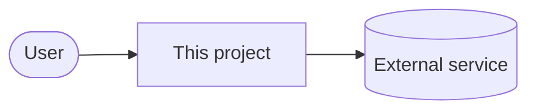
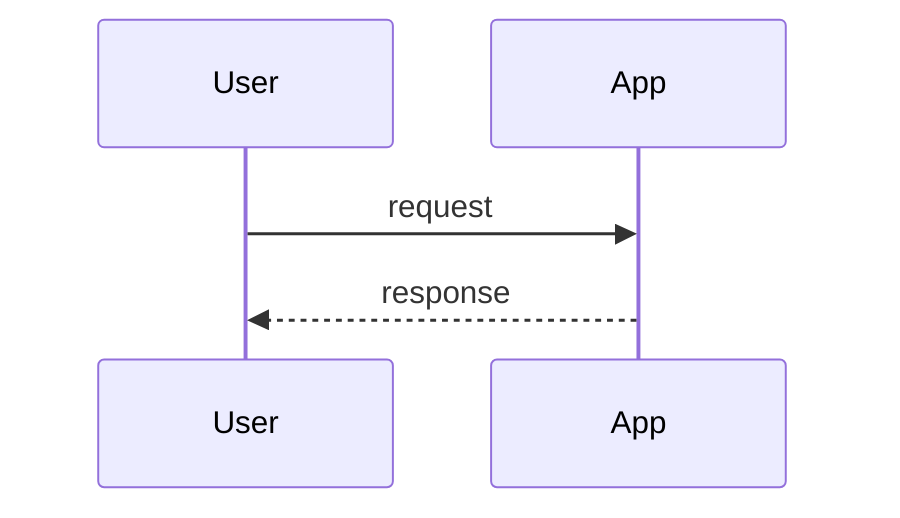

<!--
  Template for docs/ARCHITECTURE.md - the detailed description of the project/app.
  This is the "deep" document: someone new must understand how the system works and why,
  without reading the code first. Every statement must be backed by the repo.
  Delete sections that do not apply; never leave placeholders.
-->
# Architecture

## Purpose and scope

<What the system does, for whom, and the boundaries (what is out of scope).>

## Context

<How the system fits into its environment: users, external systems, upstream/downstream services.>

## Components

<One subsection per component (service, job, module, Helm release, script).>

### <Component>
- **Responsibility:** ...
- **Technology:** ... (language/framework/chart and version source)
- **Location in the repo:** `path/`
- **Interfaces:** ports, endpoints, queues, files, CLI parameters
- **Depends on:** ...

## Data flow

<The important flows step by step, ideally as a Mermaid sequence diagram.>

## Data and state

<What is persisted where (databases, volumes, object storage), retention, backup and restore approach.>

## Configuration

<Where configuration comes from (env vars, config files, Helm values, Flux substitutions, SOPS/ExternalSecrets) and how
the layers override each other. Reference table of all settings derived from the code.>

## Deployment

<How the system gets deployed (GitOps/Flux, CI/CD, manual), environments, update strategy (Renovate), rollback.>

## Security model

<Trust boundaries, authentication/authorization, exposure (internal/external), secret handling, network policies,
least privilege. Summarize - link SECURITY.md for the reporting process.>

## Observability

<Logs, metrics, dashboards, alerts, health checks - only what exists.>

## Design decisions

<Important decisions and their reasons (lightweight ADRs): context, decision, consequences.>

## Known limitations and open points

<Honest list of limitations, technical debt and unanswered questions.>
