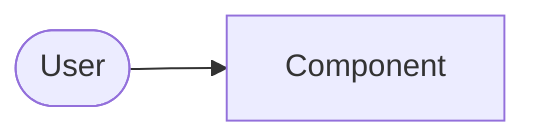

<!--
  Template for a repository README (used by the docs-writer).
  Fill every section with VERIFIED facts from the repo. Delete sections that do not apply
  (e.g. "Usage" for a pure GitOps repo) - do not leave placeholders behind.
  HTML comments like this one are instructions and must not end up in the result.
-->
# <Project name>

<One or two sentences: what it is and who it is for.>

<!-- Badges only if they exist for real (CI workflow, license, release). No invented badges. -->

## Overview

<What problem it solves, the main capabilities as a short bullet list, and what it deliberately does not do.>

## Architecture at a glance

<Three to six sentences plus a small Mermaid diagram of the main components and data flows.
Link to docs/ARCHITECTURE.md for the details.>

## Getting started

### Prerequisites
<Tools with versions, where they come from (e.g. `.mise.toml`), accounts/access needed.>

### Installation / deployment
<The real commands, copied from the repo (justfile, Makefile, package.json scripts, Taskfile, CI).>

### Configuration
<Table of the settings that matter. Derive names and defaults from the code/config - never invent.>

| Name | Required | Default | Description |
|---|---|---|---|

## Usage

<Typical tasks with commands or examples. For services: endpoints/UI, for scripts: invocation and parameters.>

## Development

<How to run locally, test, lint and format. Conventions (Conventional Commits, branch naming). Link CONTRIBUTING.md.>

## Project structure

<Short annotated tree of the top-level folders - only the ones that matter.>

## Documentation

- [Architecture](docs/ARCHITECTURE.md)
- [Operations](docs/OPERATIONS.md)
- [Security policy](SECURITY.md)
- [Contributing](CONTRIBUTING.md)

## License

<Name of the license, link to LICENSE. If there is no LICENSE file, say so explicitly ("All rights reserved").>
